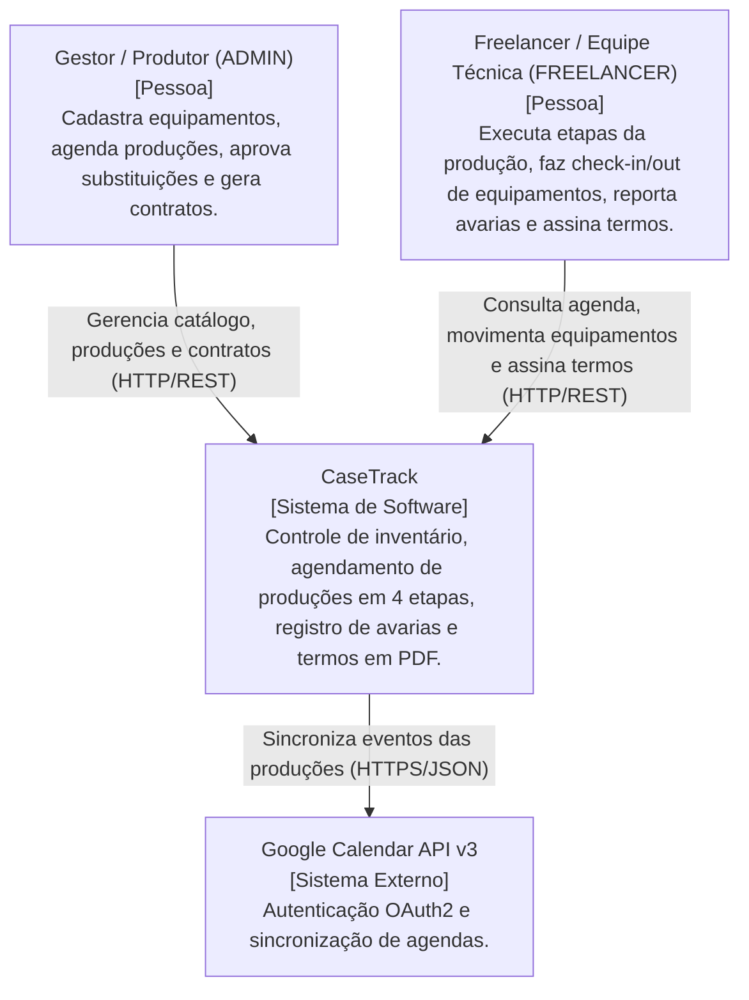
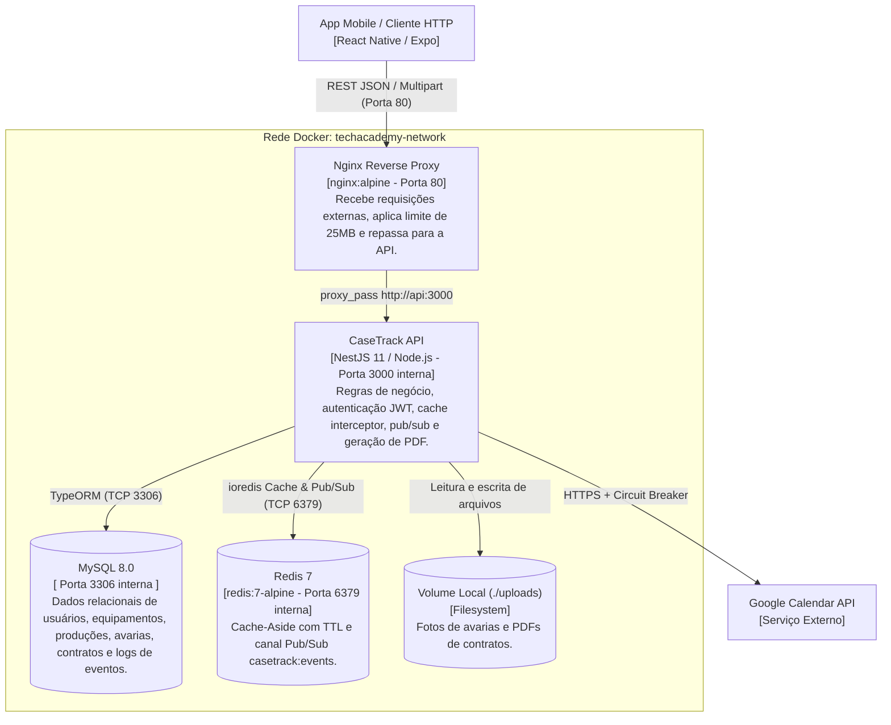

# Arquitetura C4 - CaseTrack

**Projeto:** CaseTrack (Gestão de Equipamentos e Produções Audiovisuais)  
**Autor:** Douglas Alexandre Marchesi

---

## 1. Nível 1 - Diagrama de Contexto

Visão geral do CaseTrack, seus perfis de acesso e integrações externas.

### Atores e Integrações
| Elemento | Tipo | Descrição |
| :--- | :--- | :--- |
| **Gestor (`ADMIN`)** | Usuário | Gerencia o inventário, cria e confirma produções (`PATCH /api/v1/productions/:id/confirm`), substitui equipamentos avariados e emite contratos em PDF. |
| **Freelancer (`FREELANCER`)** | Usuário | Consulta tarefas pendentes (`GET /api/v1/productions/my/pending`), retira (`checkout`) e devolve (`checkin`) equipamentos, registra avarias com foto e assina termos. |
| **Google Calendar API** | Externo | Recebe os agendamentos das produções. A chamada passa por um Circuit Breaker (`opossum`) para evitar travamentos caso a API do Google fique indisponível. |

---

## 2. Nível 2 - Diagrama de Containers

Estrutura de execução definida no `docker-compose.yml`. Todos os serviços rodam na rede interna `techacademy-network`, sendo o **Nginx** o único container exposto na porta 80 do host.

### Resumo dos Containers
| Container | Imagem / Stack | Porta | Responsabilidade |
| :--- | :--- | :--- | :--- |
| **`nginx`** | `nginx:alpine` | `80:80` (pública) | Proxy reverso para `http://api:3000`, repasse de headers (`Host`, `X-Real-IP`, `X-Forwarded-For`), timeout de `60s` e limite de upload de `25M`. |
| **`api`** | NestJS 11 / TypeScript | `3000` (`expose` interno) | Backend estruturado como monólito modular (`Auth`, `Users`, `Equipments`, `Productions`, `Damages`, `Contracts`, `Redis`, `Events`). |
| **`mysqldb`** | `mysql:8.0` | `3306` | Banco relacional principal com transações ACID e controle de concorrência (`SELECT ... FOR UPDATE`). |
| **`redis`** | `redis:7-alpine` | `6379` (`expose` interno) | Cache de consultas frequentes (`volatile-lru`, máx `256mb`) e mensageria assíncrona via Pub/Sub. |
