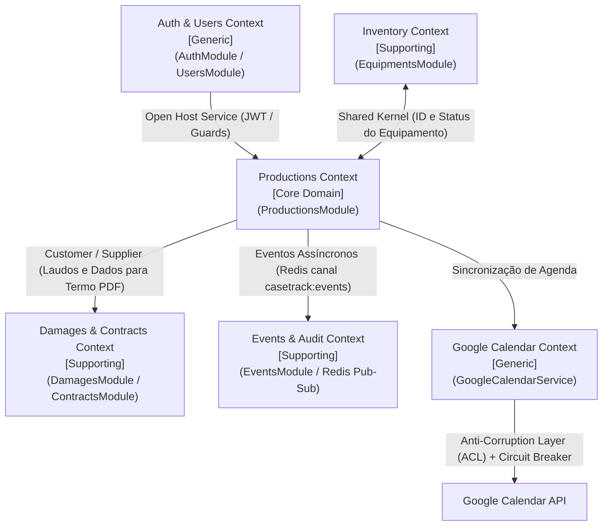
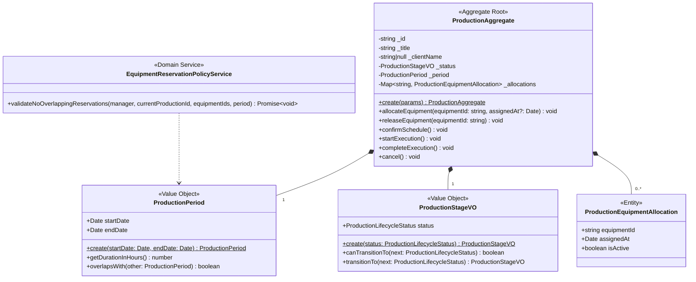

# Modelagem DDD - Context Map e Modelo Tático

**Projeto:** CaseTrack  
**Autor:** Douglas Alexandre Marchesi

---

## 1. Subdomínios e Bounded Contexts (DDD Estratégico)

O sistema é dividido em 5 contextos delimitados (*Bounded Contexts*), organizados como módulos dentro do NestJS:

| Bounded Context | Tipo de Subdomínio | Módulo no Código | Escopo |
| :--- | :--- | :--- | :--- |
| **Produções e Reservas** | **Core Domain** (Principal) | `src/productions` | Agendamento de produções, reserva de equipamentos sem conflito de horário, controle das 4 etapas (`CAPTACAO`, `EDICAO`, `BACKUP`, `UPLOAD`) e movimentações (`checkout`/`checkin`). |
| **Inventário de Equipamentos** | **Supporting** (Suporte) | `src/equipments` | Cadastro de câmeras, lentes e acessórios, número de série e status operacional (`DISPONIVEL`, `EM_USO`, `MANUTENCAO`). |
| **Avarias e Contratos** | **Supporting** (Suporte) | `src/damages`, `src/contracts` | Registro de avarias com upload de fotos durante a inspeção e geração/assinatura de termos de responsabilidade em PDF. |
| **Autenticação e Usuários** | **Generic** (Genérico) | `src/auth`, `src/users` | Login com JWT e validação de permissões por perfil (`ADMIN` e `FREELANCER`). |
| **Integração Google Agenda** | **Generic** (Genérico) | `src/productions/google-calendar.service.ts` | Conexão OAuth2 e envio de eventos para o Google Calendar com proteção de Circuit Breaker. |

---

## 2. Context Map

Relacionamento entre os contextos dentro do monólito modular:

---

## 3. Modelagem Tática DDD - Contexto de Produções

O núcleo de domínio do módulo de produções foi isolado em `api/src/productions/domain/` para separar as regras de negócio das entidades do TypeORM.

### Componentes Implementados

1. **Aggregate Root (`ProductionAggregate`)** - [`api/src/productions/domain/production.aggregate.ts`](../../api/src/productions/domain/production.aggregate.ts)
   - Centraliza as alterações de estado da produção e a lista de equipamentos alocados.
   - Impede alocação duplicada do mesmo equipamento ativo na mesma produção.
   - Bloqueia alocação de equipamentos caso a produção já esteja concluída (`COMPLETED`) ou cancelada (`CANCELLED`).
   - Exige pelo menos 1 equipamento ativo para confirmar o agendamento (`confirmSchedule()`).

2. **Value Objects Imutáveis**
   - **`ProductionPeriod`** ([`production-period.vo.ts`](../../api/src/productions/domain/value-objects/production-period.vo.ts)): Valida se `endDate > startDate`, exige duração mínima de 1 hora e calcula se há conflito de horário entre dois períodos (`overlapsWith`).
   - **`ProductionStageVO`** ([`production-stage.vo.ts`](../../api/src/productions/domain/value-objects/production-stage.vo.ts)): Controla as transições válidas de status (`DRAFT -> SCHEDULED -> IN_PROGRESS -> COMPLETED` ou `CANCELLED`), impedindo que uma produção finalizada ou cancelada volte a estados anteriores.

3. **Entidade Interna (`ProductionEquipmentAllocation`)**
   - Representa o vínculo de um equipamento dentro do agregado (`equipmentId`, `assignedAt`, `isActive`), permitindo liberar um equipamento avariado sem apagar o histórico da produção.

4. **Domain Service (`EquipmentReservationPolicyService`)** - [`equipment-reservation-policy.service.ts`](../../api/src/productions/domain/services/equipment-reservation-policy.service.ts)
   - Verifica se os equipamentos escolhidos já estão reservados em outra produção ativa no mesmo período.
   - Ordena os IDs e aplica lock pessimista (`SELECT ... FOR UPDATE`) no MySQL durante a transação de confirmação, evitando que dois usuários reservem o mesmo item ao mesmo tempo.

5. **Mapper (`ProductionMapper`)** - [`production.mapper.ts`](../../api/src/productions/domain/production.mapper.ts)
   - Converte entre a entidade do TypeORM (`Production`) e o agregado de domínio (`ProductionAggregate`).
