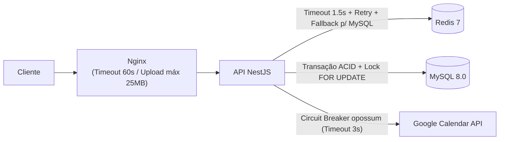
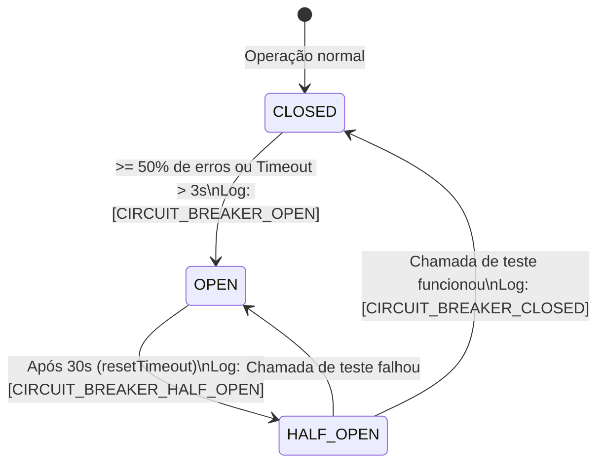

# Resiliência e Plano de Observabilidade

**Projeto:** CaseTrack  
**Autor:** Douglas Alexandre Marchesi

---

## 1. Estratégias de Resiliência

O sistema utiliza timeouts, retentativas (retry) e circuit breaker para evitar que falhas no Redis, no banco ou na API do Google derrubem a aplicação.



### Configurações Aplicadas
| Mecanismo | Onde está aplicado | Configuração | Comportamento em caso de falha |
| :--- | :--- | :--- | :--- |
| **Timeout HTTP** | Nginx (`nginx/nginx.conf`) | `proxy_connect_timeout 60s;`<br>`proxy_read_timeout 60s;`<br>`client_max_body_size 25M;` | Encerra conexões presas com `504 Gateway Timeout` e bloqueia uploads maiores que 25MB. |
| **Timeout e Retry no Redis** | `RedisModule` ([`redis.module.ts`](../../api/src/redis/redis.module.ts)) | `connectTimeout: 3000ms`<br>`commandTimeout: 1500ms`<br>Backoff: `Math.min(times * 200, 2000)` (máx 5 tentativas) | Evita que a API trave esperando o Redis. Após 5 falhas de reconexão, pausa novas tentativas. |
| **Fallback de Cache** | `RedisService` e `CacheInterceptor` | Blocos `try/catch` nas operações do Redis | Se o Redis estiver offline, ignora o cache e busca os dados direto no MySQL sem retornar erro 500. |
| **Circuit Breaker** | `GoogleCalendarService` ([`google-calendar.service.ts`](../../api/src/productions/google-calendar.service.ts)) | Biblioteca `opossum`:<br>`timeout: 3000ms`<br>`errorThresholdPercentage: 50`<br>`resetTimeout: 30000ms` | Se a API do Google falhar ou demorar mais de 3s, abre o circuito por 30s e retorna aviso amigável (`calendarSynced: false`). |
| **Prevenção de Deadlock** | `EquipmentReservationPolicyService` | Ordenação dos IDs antes do `SELECT ... FOR UPDATE` | Garante que transações concorrentes travem os equipamentos na mesma ordem no MySQL. |
| **Limpeza de Upload** | `DamagesController` | `fs.promises.unlink` no `catch` | Remove do disco as fotos enviadas caso ocorra erro ao salvar o registro da avaria no banco. |

---

## 2. Estados do Circuit Breaker (`opossum`)



---

## 3. Plano de Observabilidade

### 3.1. Logs da Aplicação
A API registra eventos padronizados no console para facilitar o acompanhamento via `docker compose logs -f api`:

* **Cache:**
  * `[CACHE HIT] Chave encontrada no Redis (namespace=equipments, epoch=1, key=...)`
  * `[CACHE MISS] Chave ausente no Redis (namespace=equipments, epoch=1, key=...). Consultando banco...`
  * `[CACHE INVALIDATE] Épocas incrementadas em O(1) para namespaces: [productions, dashboard]`
* **Mensageria Pub/Sub:**
  * `[PUB/SUB PUBLISH] Evento enviado ao canal casetrack:events: <payload JSON>`
  * `[PUB/SUB SUBSCRIBE] Evento recebido no canal casetrack:events: <payload JSON>`
* **Circuit Breaker:**
  * `[CIRCUIT_BREAKER_OPEN] Circuito aberto para Google Calendar API. Ativando fallback gracioso.`
* **Erros HTTP:**
  * `[HttpExceptionFilter] <METHOD> <PATH> -> <STATUS> (correlationId=<UUID>): <MENSAGEM>`

### 3.2. Padronização de Erros (`HttpExceptionFilter`)
Qualquer erro na API é formatado pelo filtro global ([`http-exception.filter.ts`](../../api/src/common/filters/http-exception.filter.ts)), que adiciona um `correlationId` (UUID v4) no header `x-correlation-id` e no corpo da resposta:

```json
{
  "statusCode": 409,
  "error": "ConflictException",
  "message": "Conflito de reserva: 1 equipamento(s) já alocado(s) em outra produção no período selecionado.",
  "timestamp": "2026-11-14T21:00:00.000Z",
  "path": "/api/v1/productions/8a1f2c90-1234-4b56-9abc-def012345678/confirm",
  "correlationId": "f47ac10b-58cc-4372-a567-0e02b2c3d479"
}
```

### 3.3. Métricas Monitoradas
| Componente | O que monitorar | Comando de verificação | Referência normal |
| :--- | :--- | :--- | :--- |
| **Containers** | Uso de CPU e Memória RAM | `docker stats --no-stream` | CPU `< 70%`, RAM API `< 512MB` |
| **Redis** | Uso de memória, hits, misses e chaves removidas | `docker compose exec redis redis-cli info stats memory` | Memória `< 256MB`, Hit Ratio `> 80%` |
| **MySQL** | Conexões ativas e espera por locks no InnoDB | `docker compose exec mysqldb mysqladmin status -p` | Espera de lock `< 500ms` |
| **Nginx** | Volume de requisições e erros HTTP `5xx` | `docker compose logs nginx` | Erros `5xx < 0.1%` |
