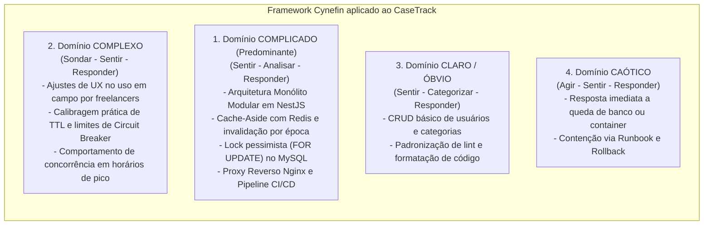

# Análise de Contexto com Framework Cynefin e Metodologia de Gestão

**Projeto:** CaseTrack  
**Autor:** Douglas Alexandre Marchesi

---

## 1. Enquadramento no Framework Cynefin

O **Framework Cynefin** (criado por Dave Snowden) auxilia na escolha do modelo de gestão de acordo com o nível de previsibilidade e a relação entre causa e efeito no projeto.

No desenvolvimento e evolução do **CaseTrack**, o sistema se posiciona predominantemente no domínio **Complicado (Complicated)**, com pontos específicos de transição para o domínio **Complexo (Complex)**.

### 1.1. Por que o projeto é predominantemente Complicado?
No domínio **Complicado**, a relação entre causa e efeito existe e é previsível, mas não é óbvia para qualquer pessoa: exige conhecimento técnico e análise antes da implementação (*Sense - Analyze - Respond*). Exemplos práticos no CaseTrack:
* **Prevenção de conflito de reservas (*double-booking*):** Sabemos que duas transações concorrentes podem alocar a mesma câmera. A solução técnica conhecida por especialistas é ordenar os IDs e aplicar bloqueio pessimista (`SELECT ... FOR UPDATE`) no MySQL.
* **Invalidação de cache sem perda de performance:** O problema de lentidão do comando `KEYS *` no Redis tem causa e efeito conhecidos; a análise técnica leva ao uso de versionamento de época (`INCR epoch:<namespace>`) em `O(1)`.
* **Isolamento de rede:** Configurar o Nginx como ponto único de entrada na porta 80 e restringir a API e o Redis à rede interna do Docker segue boas práticas consolidadas de engenharia de software.

### 1.2. Onde surgem características do domínio Complexo?
No domínio **Complexo**, certas respostas só são descobertas na prática após colocar a funcionalidade em uso e medir o resultado (*Probe - Sense - Respond*):
* Ajuste fino do tempo de expiração (TTL de 60s) conforme o ritmo real de atualização do inventário pela produtora.
* Calibragem do limiar de abertura do Circuit Breaker (`opossum`) frente a oscilações reais da API do Google Calendar.
* Adaptação do fluxo de inspeção fotográfica de avarias e substituição de equipamentos durante diárias reais de gravação.

---

## 2. Escolha e Defesa da Abordagem Metodológica

Para lidar com um núcleo arquitetural **Complicado** e evoluções incrementais **Complexas**, adotamos uma abordagem **Ágil Híbrida (Scrum + Kanban / Scrumban)**:

1. **Iterações curtas e entregas incrementais (base Scrum):**
   * O ciclo de desenvolvimento foi dividido em 3 releases incrementais (`v0.8.0-alpha`, `v0.8.0-beta` e `v1.0.0`), garantindo que a infraestrutura (Docker, Nginx e Redis) estivesse funcional antes de acoplar as regras de negócio e a documentação.
2. **Gestão visual de fluxo contínuo (Kanban no Jira):**
   * Quadro dividido nas colunas `To Do -> In Progress -> Code Review -> Done`, com limite de trabalho em progresso (*WIP Limit*) para evitar tarefas acumuladas sem testes.
3. **Por que não usar o modelo Cascata (Waterfall)?**
   * Em um modelo tradicional em cascata, problemas de integração entre o proxy Nginx, as três conexões do Redis (Cache, Pub e Sub) e o lock transacional do TypeORM só seriam descobertos no final do projeto. O fluxo iterativo permitiu testar e validar cada camada separadamente com testes automatizados a cada entrega.

