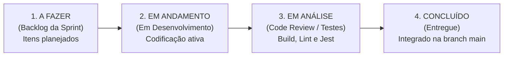

# Estruturação do Projeto e Relatório de Acompanhamento no Jira

**Projeto:** CaseTrack (Chave do Projeto no Jira: `SCRUM`)  
**Responsável:** Douglas Alexandre Marchesi (`marchesido`)  
**Quadro Jira:** `https://marchesido.atlassian.net/jira/software/projects/SCRUM/boards/1`

---

## 1. Configuração do Fluxo de Trabalho (Workflow do Quadro)

O quadro Scrum/Kanban do projeto no Jira está estruturado em 4 colunas sequenciais para garantir revisão técnica e validação de testes antes da conclusão:

* **A fazer:** Tarefas detalhadas com critérios de aceite definidos e atribuídas ao responsável.
* **Em andamento:** Tarefas em implementação ativa.
* **Em análise:** Verificação de build (`npm run build`), testes unitários (`npm test`) e validação dos containers no Docker Compose.
* **Concluído:** Código validado, documentado e integrado na branch `main`.

---

## 2. Mapeamento de Issues no Jira (`SCRUM-28` a `SCRUM-50`)

Abaixo está o registro consolidado de **Epics**, **Histórias (User Stories)**, **Tarefas Técnicas** e **Bugs** cadastrados no Jira:

### 2.1. Epics (Cronograma e Módulos Principais)
| Key | Tipo | Resumo (Summary) | Responsável | Status | Release |
| :--- | :--- | :--- | :--- | :--- | :--- |
| `SCRUM-28` | Epic | Infraestrutura Docker, Proxy Reverso Nginx e Isolamento de Rede | Douglas Marchesi | `Concluído` | `v0.8.0-alpha` |
| `SCRUM-29` | Epic | Cache Distribuído (Cache-Aside) e Mensageria Pub/Sub com Redis | Douglas Marchesi | `Concluído` | `v0.8.0-alpha` |
| `SCRUM-30` | Epic | Modelagem DDD, Concorrência no MySQL e Ciclo de Produções | Douglas Marchesi | `Concluído` | `v0.8.0-beta` |
| `SCRUM-31` | Epic | Documentação Arquitetural, Pipeline CI/CD, Runbook e Governança | Douglas Marchesi | `Em andamento` | `v1.0.0` |

---

### 2.2. Histórias de Usuário (User Stories)
| Key | Epic Pai | Resumo (Summary) | Responsável | Story Points | Status no Quadro | Commit |
| :--- | :--- | :--- | :--- | :---: | :--- | :--- |
| `SCRUM-32` | `SCRUM-28` | Como admin de infra, quero expor apenas o Nginx na porta 80 isolando a API e o Redis na rede interna | Douglas Marchesi | 5 | `Concluído` | `6d92d25` |
| `SCRUM-33` | `SCRUM-29` | Como usuário, quero consultas rápidas em equipamentos e produções com Cache-Aside e TTL de 60s | Douglas Marchesi | 8 | `Concluído` | `677796b` |
| `SCRUM-34` | `SCRUM-29` | Como gestor, quero invalidação imediata do cache ao criar, editar ou remover registros | Douglas Marchesi | 5 | `Concluído` | `677796b` |
| `SCRUM-35` | `SCRUM-30` | Como produtor, quero validação com lock pessimista ao confirmar reservas para evitar conflito de horário | Douglas Marchesi | 8 | `Concluído` | `da0621b` |
| `SCRUM-36` | `SCRUM-29` | Como sistema, quero publicar e consumir eventos no Redis Pub/Sub após a confirmação da produção | Douglas Marchesi | 5 | `Concluído` | `c58baa3` |
| `SCRUM-37` | `SCRUM-31` | Como produtor, quero que falhas na API do Google Calendar sejam isoladas por Circuit Breaker | Douglas Marchesi | 5 | `Concluído` | `c58baa3` |

---

### 2.3. Bugs Identificados e Corrigidos
| Key | Epic Pai | Resumo do Bug | Causa Raiz e Correção Aplicada | Responsável | Status no Quadro | Commit |
| :--- | :--- | :--- | :--- | :--- | :--- | :--- |
| `SCRUM-38` | `SCRUM-29` | `[BUG]` Conexão do Redis bloqueava leituras de cache após ativar o comando `SUBSCRIBE` | Um cliente `ioredis` em modo subscriber não aceita comandos `GET`/`SETEX`. Foram separadas 3 conexões independentes no `RedisModule`. | Douglas Marchesi | `Concluído` | `677796b` |
| `SCRUM-39` | `SCRUM-29` | `[BUG]` Parâmetros de paginação em ordem diferente (`?skip=0&take=10` vs `?take=10&skip=0`) geravam chaves duplicadas | Adicionada ordenação alfabética das chaves de query (`canonicalizeQuery`) antes de gerar o hash SHA-256 no `CacheInterceptor`. | Douglas Marchesi | `Concluído` | `677796b` |
| `SCRUM-40` | `SCRUM-30` | `[BUG]` Risco de publicar evento no Redis antes da confirmação da transação no MySQL | Movida a chamada `publishDomainEvent` no `ProductionsService` para executar somente após o `queryRunner.commitTransaction()`. | Douglas Marchesi | `Concluído` | `c58baa3` |
| `SCRUM-41` | `SCRUM-30` | `[BUG]` Risco de deadlock no MySQL ao bloquear vários equipamentos em produções concorrentes | Adicionada ordenação prévia dos UUIDs (`[...new Set(equipmentIds)].sort()`) antes do `SELECT ... FOR UPDATE`. | Douglas Marchesi | `Concluído` | `da0621b` |

---

### 2.4. Tarefas Técnicas (Technical Tasks)
| Key | Epic Pai | Resumo (Summary) | Responsável | Estimativa | Status no Quadro | Commit |
| :--- | :--- | :--- | :--- | :---: | :--- | :--- |
| `SCRUM-42` | `SCRUM-28` | Criar `nginx/nginx.conf` com `proxy_pass`, headers `X-Forwarded` e limite de upload de 25MB | Douglas Marchesi | 2 SP | `Concluído` | `6d92d25` |
| `SCRUM-43` | `SCRUM-28` | Configurar serviço `redis:7-alpine` (`volatile-lru` 256MB) e healthchecks no `docker-compose.yml` | Douglas Marchesi | 2 SP | `Concluído` | `6d92d25` |
| `SCRUM-44` | `SCRUM-29` | Implementar `RedisModule` com 3 conexões `ioredis` segregadas (`Cache`, `Publisher`, `Subscriber`) | Douglas Marchesi | 3 SP | `Concluído` | `677796b` |
| `SCRUM-45` | `SCRUM-29` | Criar decorators `@Cacheable` e `@InvalidateCache` com hash SHA-256 de query params | Douglas Marchesi | 3 SP | `Concluído` | `677796b` |
| `SCRUM-46` | `SCRUM-30` | Implementar `ProductionAggregate`, `ProductionPeriod`, `ProductionStageVO` e `ProductionMapper` | Douglas Marchesi | 5 SP | `Concluído` | `da0621b` |
| `SCRUM-47` | `SCRUM-29` | Criar entidade `EventAuditLog` e consumidor `EventsSubscriber` escutando `casetrack:events` | Douglas Marchesi | 3 SP | `Concluído` | `677796b` |
| `SCRUM-48` | `SCRUM-30` | Implementar suíte de testes unitários Jest para Redis, CacheInterceptor, Aggregate e ReservationPolicy | Douglas Marchesi | 5 SP | `Em análise` | `e162123` |
| `SCRUM-49` | `SCRUM-31` | Elaborar diagramas C4, Context Map DDD, ADRs 001-003, Quality Scenarios e OpenAPI 3.0 | Douglas Marchesi | 5 SP | `Em andamento` | `6dd9198`..`9f664bb` |
| `SCRUM-50` | `SCRUM-31` | Configurar pipeline `.github/workflows/ci-cd.yml` e Runbook operacional de incidentes | Douglas Marchesi | 3 SP | `A fazer` | `56df6ba`..`0227d47` |

---

## 3. Resumo da Distribuição no Quadro Jira

| Etapa / Coluna do Quadro | Quantidade de Cartões na Sprint | Issues |
| :--- | :---: | :--- |
| **A fazer** | 1 | `SCRUM-50` |
| **Em andamento** | 1 | `SCRUM-49` |
| **Em análise** | 1 | `SCRUM-48` |
| **Concluído** | 16 | `SCRUM-32` a `SCRUM-47` |
| **Epics no Cronograma** | 4 | `SCRUM-28` a `SCRUM-31` |
| **Total no Projeto Jira** | **23 Issues** | **`SCRUM-28` a `SCRUM-50`** |
