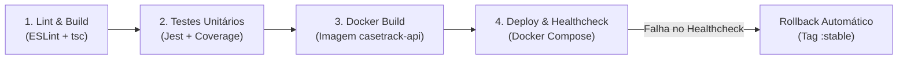

# Estratégia de Deploy e Runbook Operacional

**Projeto:** CaseTrack  
**Autor:** Douglas Alexandre Marchesi

---

## 1. Estratégia de Deploy e Rollback

O CaseTrack utiliza a estratégia de **Deploy Simples com Validação de Healthcheck e Rollback de Imagem** sobre Docker Compose, automatizada pelo workflow [`.github/workflows/ci-cd.yml`](../../.github/workflows/ci-cd.yml).

### Fluxo da Pipeline de CI/CD


1. **Integração Contínua (CI):** A cada `push` ou `pull_request`, o GitHub Actions instala as dependências (`npm ci`), valida a formatação e tipagem (`npm run lint` e `npm run build`) e executa a bateria de testes unitários (`npm test -- --coverage`) cobrindo `RedisService`, `CacheInterceptor`, `ProductionAggregate` e `EquipmentReservationPolicyService`.
2. **Empacotamento:** Gera a imagem Docker da API com a tag do commit (`casetrack-api:<sha>`) e valida a sintaxe do `docker-compose.yml`.
3. **Atualização do Serviço:** Antes de subir a versão nova, a imagem em execução é preservada sob a tag `casetrack-api:stable`. O comando `docker compose up -d --no-deps --build api` recria apenas o container da API, mantendo o MySQL, o Redis e o Nginx ativos.
4. **Procedimento de Rollback:** Se o container `casetrack_api` falhar no healthcheck após 3 tentativas ou apresentar erro crítico nos logs pós-deploy, a versão anterior é restaurada imediatamente:

```bash
# Reverter para a imagem estável anterior
docker tag casetrack-api:stable casetrack-api:latest
docker compose up -d --no-deps api
```

---

## 2. Runbook de Resposta a Incidentes

Guia prático para diagnóstico e recuperação rápida dos serviços em caso de falha no ambiente.

### Comandos Gerais de Diagnóstico
```bash
# Verificar status e saúde (healthy / unhealthy) de todos os containers
docker compose ps

# Acompanhar logs em tempo real de todos os serviços (ou apenas da api)
docker compose logs -f
docker compose logs -f --tail=100 api

# Verificar consumo de CPU e memória RAM de cada container
docker stats --no-stream
```

---

### Incidente 1: API Parou de Responder ou Nginx Retorna `502 Bad Gateway`

* **Sintoma:** O aplicativo mobile recebe erro `502 Bad Gateway` ou `504 Gateway Timeout` ao chamar rotas em `http://localhost/api/v1/...`.
* **Causa provável:** O container `casetrack_api` caiu, travou por falta de memória ou perdeu conexão com o banco na inicialização.
* **Passo a passo de resolução:**
  1. Checar o estado do container da API:
     ```bash
     docker compose ps api
     ```
  2. Inspecionar as últimas linhas de erro da API procurando por exceções não tratadas ou falha de conexão:
     ```bash
     docker compose logs --tail=50 api
     ```
  3. Reiniciar o serviço da API:
     ```bash
     docker compose restart api
     ```
  4. Validar se o proxy Nginx voltou a encaminhar requisições:
     ```bash
     curl -i http://localhost/api/v1/auth/profile
     # Esperado: HTTP/1.1 401 Unauthorized (confirma que a API respondeu)
     ```

---

### Incidente 2: Queda ou Indisponibilidade do Container Redis (`casetrack_redis`)

* **Sintoma:** Nos logs da API aparecem avisos `[RedisModule] Erro no cliente Redis` ou `[Fallback Gracioso]`, e todas as respostas HTTP vêm com `X-Cache: MISS`.
* **Impacto no sistema:** **Baixo (sem queda da API).** Graças ao fallback no `RedisService` e no `CacheInterceptor`, as rotas `GET /equipments` e `GET /productions` continuam funcionando e buscam os dados direto no MySQL. Apenas o cache e o disparo de eventos Pub/Sub ficam pausados até o Redis voltar.
* **Passo a passo de resolução:**
  1. Verificar se o container do Redis parou ou atingiu o limite de memória (`256mb`):
     ```bash
     docker compose ps redis
     docker compose logs --tail=50 redis
     ```
  2. Subir ou reiniciar o container do Redis:
     ```bash
     docker compose up -d redis
     ```
  3. Testar a resposta do Redis internamente:
     ```bash
     docker compose exec redis redis-cli ping
     # Esperado: PONG
     ```
  4. Verificar as estatísticas de memória e chaves:
     ```bash
     docker compose exec redis redis-cli info memory
     ```

---

### Incidente 3: Lentidão ou Travamento no Banco de Dados MySQL (`casetrack_mysql`)

* **Sintoma:** Requisições de escrita ou confirmação de produção (`PATCH /api/v1/productions/:id/confirm`) demoram mais de 5 segundos ou retornam erro 500 de timeout de query.
* **Causa provável:** Conexões esgotadas no pool ou alguma transação travada segurando lock (`SELECT ... FOR UPDATE`) no InnoDB.
* **Passo a passo de resolução:**
  1. Verificar a saúde do container `mysqldb`:
     ```bash
     docker compose ps mysqldb
     docker compose logs --tail=50 mysqldb
     ```
  2. Consultar processos ativos e locks travados dentro do MySQL:
     ```bash
     docker compose exec mysqldb mysql -u root -proot -e "SHOW FULL PROCESSLIST;"
     docker compose exec mysqldb mysql -u root -proot -e "SELECT * FROM information_schema.innodb_trx;"
     ```
  3. Caso exista uma conexão órfã segurando lock há muito tempo, encerrar a thread correspondente (`KILL <trx_mysql_thread_id>;`) ou reiniciar o serviço se necessário:
     ```bash
     docker compose restart mysqldb api
     ```

---

### Incidente 4: Falha na Sincronização com o Google Calendar API

* **Sintoma:** A rota `POST /api/v1/productions/:id/sync-google` retorna `{ "calendarSynced": false, "warning": "Agenda externa temporariamente indisponível (Circuit Breaker ativo)" }`.
* **Impacto no sistema:** **Isolado.** O Circuit Breaker (`opossum`) abriu porque a API do Google respondeu com erro em mais de 50% das tentativas ou excedeu 3 segundos de timeout. O restante do CaseTrack continua operando normalmente.
* **Passo a passo de resolução:**
  1. Verificar nos logs da API o motivo da abertura do circuito:
     ```bash
     docker compose logs api | grep "CIRCUIT_BREAKER"
     ```
  2. Caso o problema seja token OAuth2 expirado ou revogado (`GOOGLE_RECONNECT_REQUIRED`), consultar o status da conta:
     ```bash
     curl -H "Authorization: Bearer <TOKEN_ADMIN>" http://localhost/api/v1/productions/google/status
     ```
  3. Se necessário, refazer a conexão OAuth2 pela rota `GET /api/v1/productions/google/auth-url`. Após 30 segundos (`resetTimeout`), o Circuit Breaker muda automaticamente para `HALF_OPEN` e testa a comunicação na próxima chamada.

